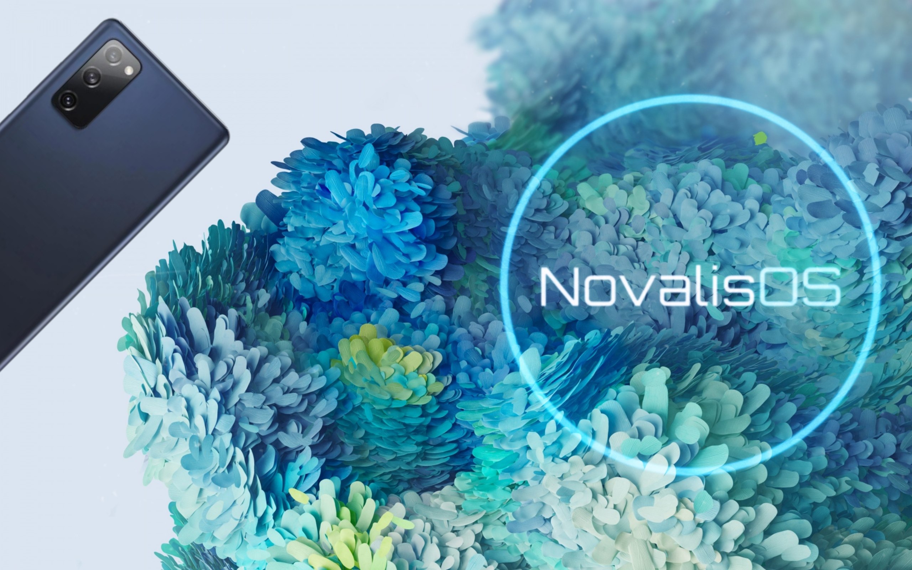

# NovalisOS 🚀

  
   
  <b>A Premium, Customizable, and Performance-Oriented One UI Port for Galaxy S20 FE 5G (r8q)</b>
   

---

## 🌟 About NovalisOS
**NovalisOS** is a next-generation One UI port built specifically for the **Samsung Galaxy S20 FE 5G (Snapdragon)**. Powered by the robust **UN1CA** base, NovalisOS bridges the gap between official software limitations and amgship performance. 

Unlike traditional bare-bones custom ROMs, NovalisOS gives the power back to the user via an **interactive, physical button-based installation wizard** right inside OrangeFox Recovery. Choose your performance, control your debloat level, and unleash the true potential of your Snapdragon 865.

---

## 🛠️ Exclusive & Custom Features (Novalis Wizard)
These options are configurable during the installation process via **Volume Keys**:

### ⚡ Performance & Kernel Profiles (Apex Engine)
* **Apex Mode:** CPU and GPU overclocked to their safe limits for maximum gaming performance.
* **Balanced Mode:** Stock frequencies optimized for the perfect daily battery life and thermal balance.
* **Battery Saver:** Aggressive governor tuning to maximize screen-on time (SOT).

### 🧼 Smart Modular Debloat
* **Full Experience:** Complete Samsung ecosystem including Galaxy AI and Bixby services.
* **Minimalist UI:** Removes heavy bloatware (Microsoft apps, Bixby, Facebook stubs) while keeping vital Samsung apps.
* **Ultra Clean:** Stripped down to the bare essentials for absolute speed and maximum free RAM.

### 🔐 Integrated Root Solutions
* **KernelSU (KSU):** Next-gen kernel-level root. Hidden out of the box, passes banking apps without effort.
* **Magisk:** Traditional root solution for ultimate module compatibility.
* **Unrooted:** Pure, clean system without root binaries.

---

## 🧬 Core & UN1CA Base Features

| Category | Included Features |
| :--- | :--- |
| **System Base** | Android 14 (Galaxy S22 Stable Firmware) • EROFS File System • Galaxy S25 Wallpapers & Sounds |
| **Galaxy AI** | Audio Eraser • Drawing Assist • Photo Assist • Interpreter • Note & Writing Assist • Call Assist |
| **Visuals & Display** | High-end Animations • Native/Live Blur Support • AOD Clock Transitions • Adaptive Refresh Rate |
| **System Enhancements** | Samsung DeX Support • Custom FlipFont Fonts • Dual Messenger for all apps • Auto 4-Digit PIN Confirm |
| **Tweaks & Spoofs** | Unlimited Google Photos Backup • Games FPS Unlock • Play Integrity Fix • TrickyStore (Key Attestation) |
| **CSC Features** | Native Call Recording • Network Speed Meter in Status Bar • AltZLife Support • Hiya Integration |

---

## 📦 Distribution & Updates
NovalisOS comes bundled with a **customized OrangeFox Recovery** featuring our unique branding. 
* **Seamless OTA Updates:** Integrated native OTA system linked directly to GitHub Releases. Update effortlessly without losing data.

---

## ⚠️ Known Issues / What's Working
* **Working:** Everything (Wi-Fi, Bluetooth, Camera, Audio, Fingerprint, AI Features, DeX).
* **In progress:** Refining initial kernel thresholds for Apex Mode.

---

## 🤝 Credits & Acknowledgements
NovalisOS wouldn't be possible without the amazing work of the Android community:
* **[UN1CA](https://github.com/salvogiangri/UN1CA) Team** - For the incredible base firmware and core features.
* **[OrangeFox Recovery Project](https://gitlab.com/OrangeFox)** - For the superior recovery environment.
* **Samsung** - For the One UI framework.

---

  <b>🔥 Snapdragon 865, Unleashed. Stay tuned for the upcoming releases! 🔥</b>

